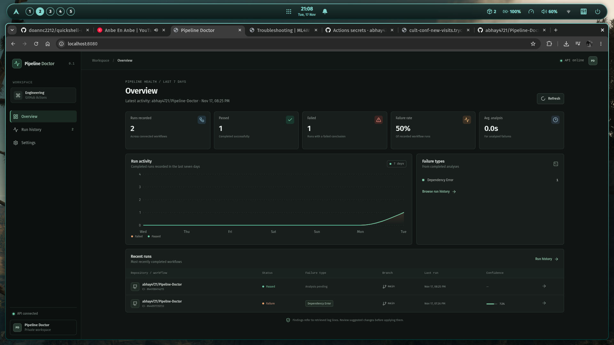
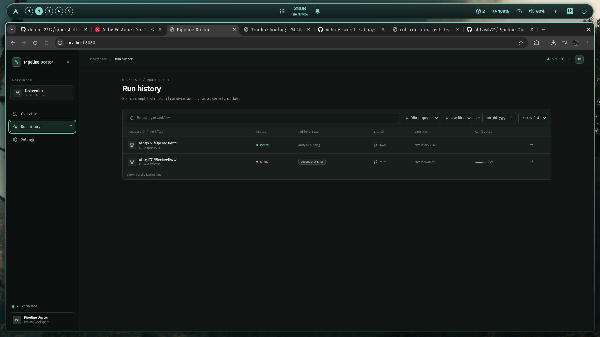
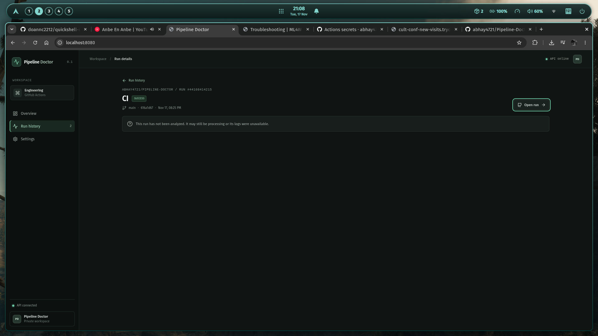
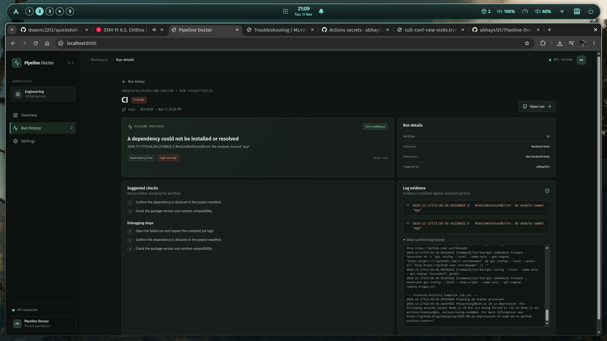

# Pipeline Doctor

Pipeline Doctor collects GitHub Actions run metadata, retrieves failed job logs, and keeps a searchable analysis with the log lines that support it. It runs locally with PostgreSQL and rule-based analysis; OpenAI and Ollama are optional providers.

## Screenshots

<table>
  <tr>
    <td></td>
    <td></td>
  </tr>
  <tr>
    <td align="center">Overview dashboard</td>
    <td align="center">Run history</td>
  </tr>
  <tr>
    <td></td>
    <td></td>
  </tr>
  <tr>
    <td align="center">Successful workflow run</td>
    <td align="center">Failure analysis and log evidence</td>
  </tr>
</table>

## Run with Docker Compose

Requirements: Docker Engine with Compose, a GitHub fine-grained token with Actions read access to the repositories you want to monitor, and the repository clone.

```sh
cp .env.example .env
```

Edit `.env` before starting. Set a unique `API_TOKEN` (at least 32 characters), a strong `POSTGRES_PASSWORD`, and a `GITHUB_TOKEN`. The webhook secret is only needed if you configure direct GitHub webhooks. Keep `.env` private; it is ignored by Git.

For example, generate random hex values with `openssl rand -hex 32` (run it separately for the API token and database password). The example values are placeholders; the API refuses to start in production while the API token is unchanged.

```sh
docker compose up --build -d
```

Open <http://localhost:8080>, paste the `API_TOKEN`, and check the API at <http://localhost:8000/health>. The API port is bound to localhost; the dashboard's Nginx serves the static app and proxies API requests internally.

The local provider needs no model service or paid account. For Ollama, start its optional service and pull a model:

```sh
docker compose --profile local-ai up -d ollama
docker compose exec ollama ollama pull llama3.1
```

Set `AI_PROVIDER=ollama` in `.env`, then restart the API with `docker compose up -d api`. For OpenAI, set `AI_PROVIDER=openai` and `OPENAI_API_KEY`. Provider credentials stay on the server and are not shown in the dashboard.

To stop the app, run `docker compose down`. Add `-v` only if you intend to delete the stored PostgreSQL data.

## Connect GitHub Actions

This repository includes a `CI` workflow and a Pipeline Doctor reporter. The CI workflow runs on pushes and pull requests. It also has a manual `simulate_failure` input for testing the reporter. Add these repository secrets:

- `PIPELINE_DOCTOR_API`: public HTTPS base URL for the service.
- `PIPELINE_DOCTOR_TOKEN`: the same value as the server's `API_TOKEN`.

The API server's `.env` must also have a real `GITHUB_TOKEN` with Actions read access to this repository. After both workflows are on the default branch, push a commit to run a passing CI check. To test a failure, open **Actions → CI → Run workflow**, enable `simulate_failure`, and start the workflow. The reporter runs after the failed CI workflow and submits its run ID.

The reporter submits the repository and run ID. The backend fetches the run, jobs, and failed logs through the GitHub API. GitHub-hosted runners need a publicly reachable HTTPS `PIPELINE_DOCTOR_API` URL; they cannot reach your computer's `localhost`. The server token must have Actions read access for each monitored repository. The reporter workflow must be present on the default branch for GitHub's `workflow_run` event to trigger it.

For direct GitHub webhooks, set the target to `https://your-host/api/v1/webhooks/github`, subscribe to `workflow_run`, and set the GitHub webhook secret to the same value as `GITHUB_WEBHOOK_SECRET`. The endpoint verifies the HMAC signature and delivery ID. Logs still come from the GitHub API.

## Development

Backend, Python 3.12 or newer:

```sh
cd backend
python -m venv .venv
. .venv/bin/activate
pip install -r requirements.txt
DATABASE_URL=sqlite:///./pipeline_doctor.db alembic upgrade head
uvicorn app.main:app --reload
```

Frontend, Node 22 or newer:

```sh
cd frontend
npm install
npm run dev
```

The Vite server proxies `/api` and `/health` to `localhost:8000`. To use another API host, set `VITE_API_URL` and allow the frontend origin in `CORS_ORIGINS`.

## API

Except `/health` and the signed webhook, endpoints require `Authorization: Bearer $API_TOKEN`.

- `GET /api/v1/stats`
- `GET /api/v1/runs?repository=owner/name&failure_type=dependency_error&severity=high&limit=50&offset=0`
- `GET /api/v1/runs/{database_id}`
- `POST /api/v1/reports/run` with `{"repository":"owner/name","run_id":123}`; returns `202` and processes the run in the background.
- `GET /api/v1/settings`; returns provider names and integration status, never secret values.
- Interactive API reference: <http://localhost:8000/docs>

## Operations and limits

Alembic applies the initial schema when the API container starts. `/health` checks the database connection. The API has an in-process limit of 120 requests per minute per client address. Background work uses FastAPI tasks, which are not durable if the process stops; use a queue and worker before running multiple API instances or handling a high volume of runs. Authentication is a shared bearer token for a private installation; per-user login and roles are not included. Suggested fixes are never applied automatically, and this version does not post comments to GitHub.

See [docs/architecture.md](docs/architecture.md) for the service layout and data model. Run checks with `cd backend && pytest` and `cd frontend && npm run build`.
